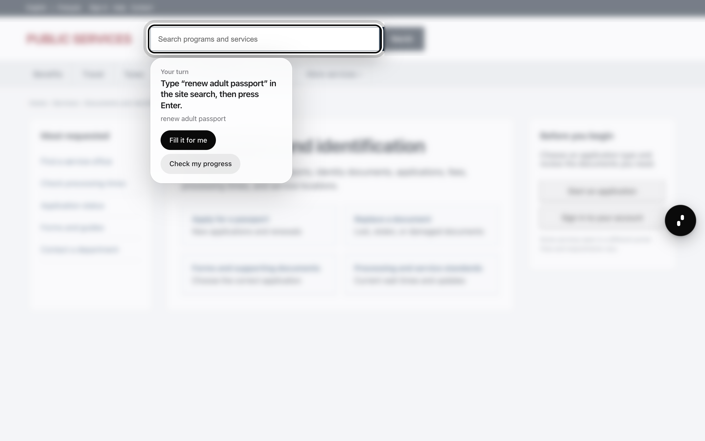
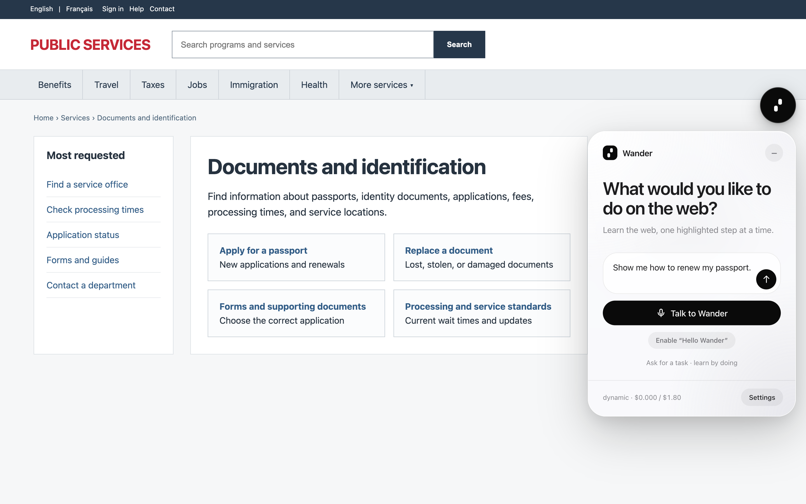
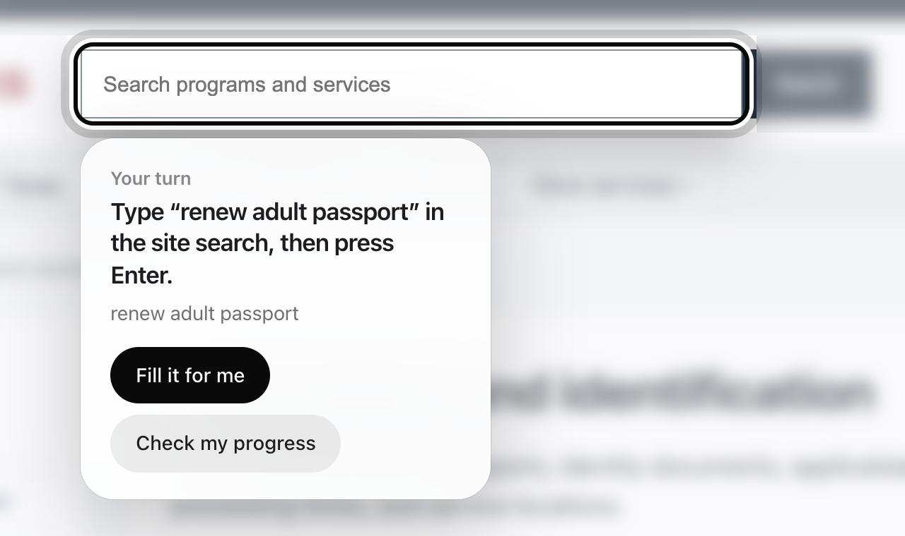
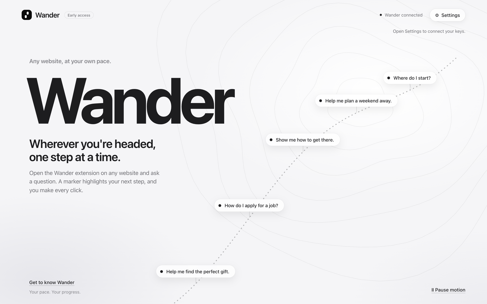
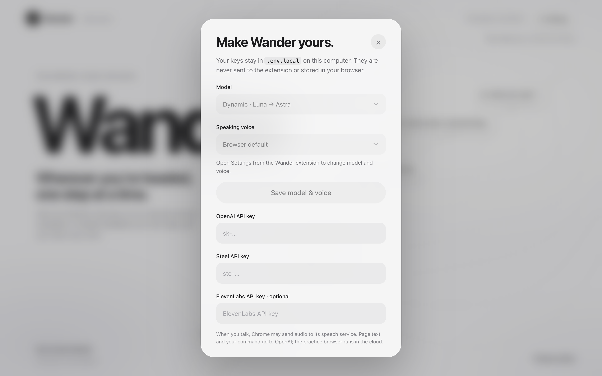

<p align="center">
  <picture>
    <source media="(prefers-color-scheme: dark)" srcset="docs/assets/logo-dark.svg">
    
  </picture>
</p>

<p align="center">
  <b>A Chrome tutor that teaches you how to use any website, one highlighted step at a time.</b>
</p>

<p align="center">
  <a href="#quick-start">Quick start</a> ·
  <a href="#using-wander">Using Wander</a> ·
  <a href="#how-it-works">How it works</a> ·
  <a href="#privacy-safety-and-limits">Privacy &amp; safety</a> ·
  <a href="#troubleshooting">Troubleshooting</a>
</p>

<p align="center">
  
  
  
  
</p>

---

Ask Wander a question by typing or speaking, for example *“Show me how to renew my passport.”* Wander studies the page, highlights the next control in your Chrome tab, and tells you what to do.

**You stay in control.** Wander never submits, navigates, or clicks for you. For ordinary, non-sensitive fields you can explicitly choose **Fill it for me** or **Choose it for me**.

<p align="center">
  
  <br>
  <sub>Wander blurs everything except the one control you need next, then explains it in plain words.</sub>
</p>

> [!NOTE]
> By default Wander runs its tutor on your computer and uses Steel only for the isolated practice browser. Set `WANDER_RUNNER=steel` in `.env.local` to run the tutor on Steel Computer (beta) instead.

## Why Wander

- **One step, not a wall of text.** Each instruction points at exactly one control on the page you are already looking at.
- **Learn by doing.** You make every click and keystroke. Wander watches the page change and adapts the next step.
- **Voice or text.** Type into the floating panel or press **Talk to Wander** and just ask.
- **Rehearsed in a sandbox.** Wander can inspect and rehearse safe public navigation in a separate, isolated Steel browser that never sees your Chrome profile, cookies, or logged-in session.
- **Safe by design.** Passwords, payments, one-time codes, and final actions such as checkout or delete are always left to you.

## Screenshots

<table>
  <tr>
    <td width="50%" valign="top">
      
      <p align="center"><sub><b>Ask anything.</b> The floating panel lives on the right of every page and can be dragged wherever you like.</sub></p>
    </td>
    <td width="50%" valign="top">
      
      <p align="center"><sub><b>Follow the marker.</b> Optional autofill for ordinary fields, and a progress check when you are ready.</sub></p>
    </td>
  </tr>
  <tr>
    <td width="50%" valign="top">
      
      <p align="center"><sub><b>Local workspace.</b> The companion page at <code>127.0.0.1:4318</code> pairs the extension and tracks usage.</sub></p>
    </td>
    <td width="50%" valign="top">
      
      <p align="center"><sub><b>Your keys stay local.</b> API keys are saved to <code>.env.local</code> on your computer, never in Chrome.</sub></p>
    </td>
  </tr>
</table>

## What you need

- [Node.js](https://nodejs.org/) 22 or newer
- Google Chrome
- An OpenAI API key
- A Steel API key with available credits (Steel Computer access is only needed with `WANDER_RUNNER=steel`)
- Python 3.9 or newer (Wander installs Playwright into `.wander/runtime` on first use)
- Optional: an ElevenLabs API key for a natural spoken voice

OpenAI, Steel, and ElevenLabs usage are billed separately by each provider.

## Quick start

### 1. Install the dependencies

From this repository's root folder, run:

```sh
npm install
```

### 2. Start Wander

```sh
npm start
```

Keep this terminal open while using Wander. The local workspace runs at [http://127.0.0.1:4318](http://127.0.0.1:4318).

On macOS, after running `npm install` once, you can alternatively double-click `Start Wander.command`.

### 3. Load the Chrome extension

1. Open `chrome://extensions` in Chrome.
2. Turn on **Developer mode**.
3. Click **Load unpacked**.
4. Select this repository's `extension` folder.
5. Pin Wander from Chrome's Extensions menu if you want its toolbar icon to remain visible.

Wander cannot run on Chrome's internal pages, including `chrome://extensions`. Open or refresh an ordinary `http://` or `https://` website before using it.

### 4. Add your keys and pair the extension

1. Open an ordinary website and click the Wander toolbar icon.
2. Click the black Wander button on the right side of the page to expand the panel.
3. Click **Connect Wander** or **Settings**. Wander opens its local settings page.
4. Enter your OpenAI and Steel API keys.
5. Click **Save keys locally**, then **Pair extension**.
6. Return to the website tab.

The keys are saved in `.env.local` on your computer. They are not stored in Chrome or sent to the extension.

You can also configure the keys manually. Copy `.env.example` to `.env.local`, fill in the values below, and restart Wander:

```dotenv
OPENAI_API_KEY=sk-...
STEEL_API_KEY=ste-...
```

### 5. Ask your first question

Open the website you want to learn, expand the Wander panel, and try:

> Show me how to search this website.

Wander will inspect the website and then highlight one control with a black-and-white marker. Follow the instruction yourself, then use **Check my progress** if Wander does not automatically detect the page change.

The first question can take a few minutes while Wander sets up its Python environment and starts an isolated Steel Browser. Later questions reuse that setup.

## Using Wander

- Type a question in the floating panel or click **Talk to Wander**.
- Click the black Wander button to open or close the panel. Spoken guidance does not open it automatically.
- Drag the panel by its header, or drag the round Wander button, to move it anywhere on the page. Wander remembers the position.
- Follow the highlighted marker in your own tab. For an ordinary text field or dropdown, use the optional autofill button if you do not want to enter the suggested value yourself.
- Use **Pause**, **Resume**, or **Stop** to control the current question.
- If “Hello Wander” is enabled, say **“Hello Wander, resume”** to continue a paused question.
- Open **Settings** to choose a model or switch between the browser voice and ElevenLabs.

Only one question can be active at a time. Pause or stop it before starting a different question.

## How it works

```
 Your Chrome tab                Local Node server              Cloud
┌──────────────────┐   observe   ┌──────────────────┐  plan   ┌───────────────┐
│ Wander extension │ ──────────► │ pairing · tasks  │ ──────► │ OpenAI        │
│ (overlay + guide)│ ◄────────── │ safety · budget  │ ◄────── │ one next step │
└──────────────────┘  highlight  └──────────────────┘         └───────────────┘
                                          │ rehearse safe public paths
                                          ▼
                                 ┌──────────────────┐
                                 │ Steel Browser    │  isolated, no cookies
                                 └──────────────────┘
```

1. The extension creates a compact observation of the visible website, including accessible frames and open shadow roots. It excludes password values.
2. The local Node server manages pairing, task state, safety checks, and the tracked OpenAI budget.
3. Steel Computer opens an isolated Steel Browser to inspect the public version of the page and save evidence.
4. OpenAI chooses one next action for the learner based on the real tab and available public evidence.
5. The extension highlights that action in the learner's tab.
6. After the learner acts, Wander observes the page again and adapts the next instruction.

Wander does not create a fixed lesson plan. It responds to the page as it changes, including when the learner takes a different path.

### Practice status

The interface distinguishes between:

- **Navigation rehearsed:** Wander verified a safe public navigation in the isolated browser.
- **Public page inspected:** Wander gathered public evidence but did not rehearse the action.
- **Guidance from your current page:** the separate browser could not inspect the page, often because it requires a login or is not publicly reachable.

## Privacy, safety, and limits

- Your cookies, Chrome profile, and logged-in session are not copied to Steel Browser.
- Visible page text and your question are sent to OpenAI through Steel Computer. Public-page evidence can be stored temporarily on that computer.
- Passwords, payment details, one-time codes, personal contact or identity fields, CAPTCHAs, and sensitive final actions are never offered for autofill and are left to you.
- Wander will not complete checkout, publish, send messages, delete records, or change account security settings.
- Chrome speech recognition may send microphone audio to Chrome's speech provider.
- The built-in ledger allows up to 60 guidance decisions per question and $1.80 of tracked OpenAI usage in total. These figures are application limits, not live provider balances. Steel costs are separate.
- Wander is designed for one trusted local user. Do not expose port 4318 to the public internet.

## Troubleshooting

| Symptom | What to do |
|---|---|
| The Wander icon does not appear on a website | Reload the extension from `chrome://extensions`, then refresh the website. Content scripts cannot run on Chrome internal pages or some protected pages. |
| The panel says the local server is offline | Run `npm start`, keep the terminal open, and confirm that [http://127.0.0.1:4318](http://127.0.0.1:4318) loads. |
| Wander asks to connect again | Open **Settings** from the extension and click **Pair extension**. Reloading the unpacked extension can change its connection state. |
| A manually edited key is not recognized | Restart `npm start` after changing `.env.local`. |
| Wander says another question is active | Resume, pause, or stop the existing question first. With wake voice enabled, say “Hello Wander, resume.” |
| You updated the source code | Reload Wander on `chrome://extensions`, then refresh every open website tab that should use the new version. |

## Wander for macOS (early test build)

`Wander.app` guides native Mac apps as well as websites. It bundles the Node tutor (run on Electron 33's Node), a standalone Python 3.12 for the practice browser, and a Swift helper that reads app windows through macOS Accessibility and draws a click-through highlight. See [TESTING.md](TESTING.md) to install and test it.

| Path | Responsibility |
|---|---|
| `desktop/` | Electron main process, preload bridge, and the Wander window |
| `native/wander-helper.swift` | Accessibility snapshots and the AppKit highlight overlay |
| `server/desktop-planner.mjs` | Validates app observations and chooses one step for native apps |
| `scripts/fetch-python.mjs` | Downloads and checksums CPython 3.12.16, then installs Playwright into it |
| `scripts/build-mac.sh` | Builds the helper, stages Python, and makes the DMG with Electron Forge |

To run from source on a Mac:

```sh
npm install
npm run fetch-python   # bundled Python for this machine, in vendor/python
npm run helper         # compiles the Swift helper into build/
npm run desktop        # opens Wander; grant Accessibility to Terminal when running this way
```

`npm run build:mac` produces `out/make/Wander-*.dmg`. Set `APPLE_SIGN_IDENTITY`, plus `APPLE_ID`, `APPLE_APP_PASSWORD`, and `APPLE_TEAM_ID` for notarization, to sign with a Developer ID. Otherwise the build is ad-hoc signed for testing.

## Development and verification

Run the automated test suite with:

```sh
npm test
```

To use an installed Chrome binary for browser-based tests, set `TEST_CHROME_PATH` first:

```powershell
$env:TEST_CHROME_PATH = "C:\Program Files\Google\Chrome\Application\chrome.exe"
npm test
```

The explicit live Steel smoke test provisions billable Steel resources but makes no OpenAI request:

```sh
node --env-file=.env.local tests/steel-tutor-smoke.mjs --live
```

To regenerate the screenshots in this README from the real extension UI (no keys or network needed):

```sh
node docs/assets/capture.mjs
```

## Project layout

| Path | Responsibility |
|---|---|
| `extension/` | Chrome extension: observe the learner's page, show the floating panel, highlight controls, and detect learner interactions |
| `server/` | Local Node server: store keys locally, pair the extension, manage tasks and budgets, and coordinate services |
| `public/` | The local workspace and settings page served at `127.0.0.1:4318` |
| `tests/` | Node test suite plus browser and Steel smoke checks |
| `promo/` | Scripts that render the promotional video from real UI captures |
| `docs/assets/` | Logo, README screenshots, and the script that captures them |

| Service | Role |
|---|---|
| Steel Computer | Run the remote tutor environment, model requests, public inspection, and evidence storage |
| Steel Browser | Provide an isolated public website session and read-only viewer |
| OpenAI | Select one safe next action for the learner |
| ElevenLabs | Optional natural voice for spoken guidance |

Key implementation files are `server/index.mjs`, `server/computer.mjs`, `server/tutor-runtime.py`, `server/planner.mjs`, `extension/background.js`, `extension/guidance.js`, `extension/page-tools.js`, and `extension/overlay.js`.
